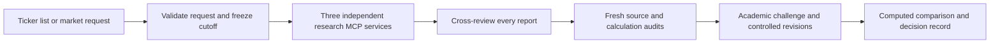

# Aethelgard MCP

Evidence-led equity and market research through the Model Context Protocol.

Compare a supplied ticker list, rank a researched candidate universe, or start with a market brief when no tickers are supplied. The workflow separates independent research, cross-review, fresh audits, academic challenge and a final decision record. Financial scenarios are computed from explicit inputs; generated opinions are never presented as measured probabilities or guaranteed returns.

## Implementation in progress

This repository is being built in focused, tested increments. Until the implementation and verification sections below are completed, this page describes the intended interface rather than claiming a deployed investment engine.

### Intended capabilities

- Configurable ticker count, dollar budget, horizons and decision cutoff.
- Current news follow-through: search, read the article, follow named sources, distinguish publication dates from event and trade dates.
- Three separate research MCP services, each performing independent research, self-validation and peer review, with one orchestrator enforcing the sequence and consolidating findings. These are research roles, not independently proven prediction engines.
- Default market discovery selects a researched candidate universe and aims to recommend 3–5 eligible stocks, without a hardcoded ticker watchlist. Evidence gaps can produce fewer recommendations.
- Side-by-side company economics, earnings definitions, cash generation, capital allocation, dilution, funding obligations, valuation and technical context.
- Deterministic return attribution, DCF, reverse valuation, portfolio scenarios and Treasury carry/duration calculations.
- Structured source ledgers, saved stage artifacts, a reproducible offline example and honest missing-data gates.
- Bring-your-own API credentials in a local ignored environment file. No brokerage orders or account access.

### Engineering approach

The server uses the official MCP Python SDK. Network providers, research orchestration, data validation and financial math are separate components so each can be tested without spending API credits. A run records its information cutoff and configuration. Historical observations, dated forecasts, assumptions and generated judgments remain distinguishable throughout the report.

### Verification policy

Offline fixtures and mocked provider tests establish behavior, arithmetic and protocol compatibility. They do not establish investment performance. Live integrations are reported separately, with their actual verification status. No API key is required for the offline examples or tests.

Development is AI-assisted. Commit messages and the verification log describe the work actually performed; this project does not claim a live trading track record.
